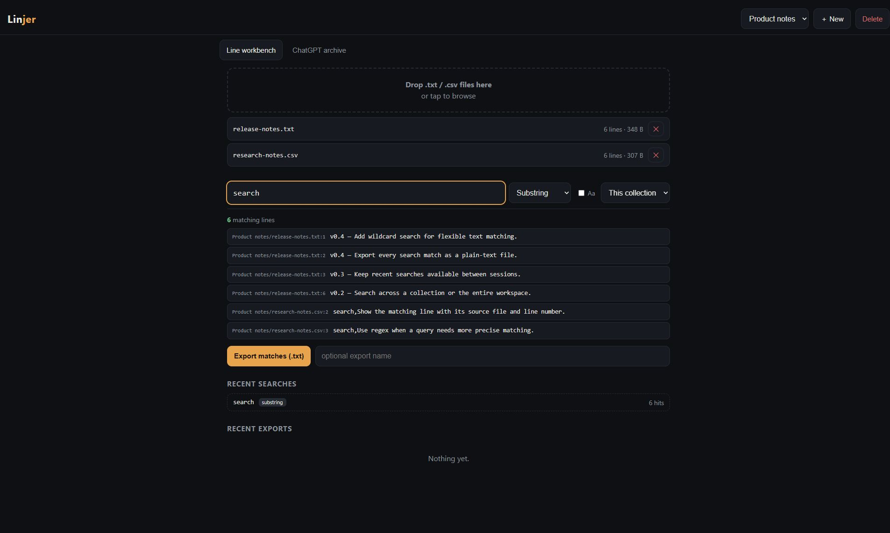

# Linjer

**A local-first workbench for searching text collections and personal conversation archives.**

Linjer brings two kinds of text search into one browser UI: line-by-line search across uploaded `.txt` and `.csv` files, and discovery across a locally exported ChatGPT archive. It is built for finding a useful line or conversation without remembering which file or folder it lives in.



*Screenshot uses fictional demo notes in a separate instance.*

## What it can do

### Search text collections

- Create collections and upload text or CSV files into them.
- Search within one collection or across all collections.
- Use substring, wildcard (`*` and `?`), or regular-expression matching, with an optional case-sensitive mode.
- Review matching lines in the browser. The results view shows up to 1,000 matches; exporting returns every match as a plain-text file.
- Revisit recent searches and exports, or remove individual files and collections.

### Explore a ChatGPT archive

Point Linjer at a ChatGPT archive-lite folder to search conversations by title, content, or both. Search by phrase or all query terms, filter by year, conversation length, or reasoning records, and sort by date, title, or length. Results include context snippets and can be downloaded as Markdown.

## How it is built

- **Bun + TypeScript server:** serves the UI and a small JSON API; no third-party runtime packages.
- **Plain HTML, CSS, and JavaScript UI:** served directly by the Bun process.
- **Local file storage:** collections, metadata, history, and exports live on the machine running Linjer.
- **Search-oriented caching:** collection lines are loaded on demand and cached for repeat queries; the optional conversation index is cached on disk.

## Run locally

Install [Bun](https://bun.sh/), then start the server:

```sh
bun run server.ts
```

Open <http://localhost:8787>. Linjer creates a local `config.json` on first run; change its `port` value to use a different port. The config, imported files, search data, and exports are excluded from Git.

The Bash helper script also supports `./linjer.sh start`, `./linjer.sh status`, and `./linjer.sh stop`.

## Add a ChatGPT archive (optional)

Set `CHATGPT_ARCHIVE_DIR` to an archive-lite folder containing `summary.json` and conversation folders with `conversation.md` and `metadata.json`. If unset, Linjer looks for `chatgpt-archive-lite` beside `server.ts`.

PowerShell:

```powershell
$env:CHATGPT_ARCHIVE_DIR = 'D:\path\to\ChatGPT-archive-lite'
bun run server.ts
```

Bash:

```sh
export CHATGPT_ARCHIVE_DIR="$HOME/path/to/ChatGPT-archive-lite"
bun run server.ts
```

## Privacy and network access

Linjer currently has no authentication and listens on all network interfaces. Anyone who can reach it can use its API, including upload and delete operations. Use it only on a trusted private network; do not expose it directly to the internet. A firewall may need to allow the selected port for other devices on your LAN.

Imported files, archive data, configuration, logs, and exports are local runtime data and are not included in this repository.
